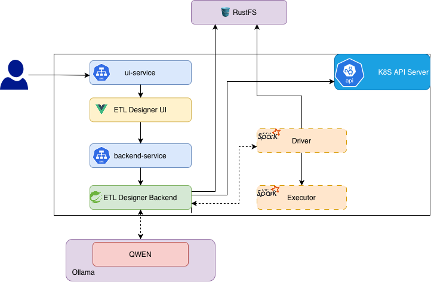

# ETL Designer Backend

The ETL Designer backend is a Spring Boot service that turns ETL workflows created in the [ETL Designer UI](https://github.com/niroshan009/etl-designer-ui) into PySpark scripts and submits those scripts as Spark applications on Kubernetes.

## Features

- Generates PySpark code from ETL graph data using Spring AI and a locally hosted Ollama model.
- Streams generated code to the client using Server-Sent Events (SSE).
- Stores generated scripts in an S3-compatible object store and submits them to a Kubernetes Spark cluster.
- Supports local development and Kubernetes deployment.

## Architecture

The UI sends workflow definitions to this backend. The backend uses Ollama to generate PySpark, stores scripts in S3-compatible storage, and configures Spark to run them on Kubernetes.



## Requirements

- Java 17
- Maven (or the included Maven Wrapper)
- Ollama with a chat model available (the default is `qwen2.5-coder:7b`)
- An S3-compatible object store, such as RustFS or MinIO
- For job submission: a Kubernetes cluster configured for Spark, a Spark application image, and a service account with permission to submit Spark applications

## API

The service listens on port `8081` by default.

| Method | Endpoint | Description |
| --- | --- | --- |
| `POST` | `/etl/create` | Accepts an ETL graph (`scriptName`, `nodes`, `edges`, and `configuration`) and streams generated PySpark code as `text/event-stream`. |
| `POST` | `/etl/submitjob` | Accepts a JSON body such as `{"scriptName":"my-etl"}` and submits the corresponding generated script to Spark on Kubernetes. |

## Local development

The `dev` profile provides local Ollama and object-store defaults. Review `src/main/resources/application-dev.yaml` and update its Spark home, Kubernetes API endpoint, and object-store settings for your environment before submitting jobs.

1. Start Ollama and make the configured model available:

   ```sh
   ollama pull qwen2.5-coder:7b
   ```

2. Start the local S3-compatible object store. The included `docker-compose.yaml` provisions RustFS and a `scripts` bucket:

   ```sh
   docker compose up -d
   ```

3. Run the backend with the development profile:

   ```sh
   ./mvnw spring-boot:run -Dspring-boot.run.profiles=dev
   ```

   Or build and run the executable JAR:

   ```sh
   ./mvnw clean package
   java -jar target/etl-designer-0.0.1.jar --spring.profiles.active=dev
   ```

## Configuration

The default `application.yaml` reads its settings from environment variables. Set the values appropriate for your environment before running without the `dev` profile.

| Area | Environment variables |
| --- | --- |
| HTTP server | `PORT` |
| Ollama | `OLLAMA_BASE_URL`, `OLLAMA_CHAT_MODEL`, `OLLAMA_CHAT_TEMPRATURE`, `OLLAMA_TOP_P` |
| S3 client | `S3_ENDPOINT`, `S3_PATH_STYLE_ENABLED`, `S3_ACCESS_KEY`, `S3_SECRET_KEY`, `S3_REGION` |
| Spark | `ETL_SPARK_MASTER`, `SPARK_HOME` |
| Script storage | `ETL_ACCESS_KEY`, `ETL_SECRET_KEY`, `ETL_REGION`, `ETL_LOCAL_SCRIPT_PATH` |
| Hadoop S3 access | `ETL_HADOOP_S3_ACCESS_KEY`, `ETL_HADOOP_S3_SECRET_KEY`, `ETL_HADOOP_S3_ENDPOINT`, `ETL_HADOOP_S3_REGION` |
| Kubernetes Spark submission | `ETL_KUBE_BASE_IMAGE`, `ETL_KUBE_NAMESPACE`, `ETL_KUBE_SERVICE_ACCOUNT`, `ETL_KUBE_FILE_UPLOAD_PATH` |

The S3-compatible store must contain a `scripts` bucket. The Spark driver and executors also need network access and credentials to read scripts from that store.

## Build and Docker image

Build the JAR and copy the application resources required by the Dockerfile:

```sh
./mvnw clean package
```

Build and optionally publish the backend image:

```sh
docker build -t niroshan009/etl-designer:latest .
docker push niroshan009/etl-designer:latest
```

The Dockerfile uses `spark:3.5.7-java17` as its base image. Configure the image's environment variables and service endpoints for your deployment rather than relying on its development-oriented defaults.

## Kubernetes deployment

Before deploying, ensure the `spark` namespace and `spark-sa` service account exist, the service account has the required permissions, and the Spark application image is available to the cluster. Configure the backend image's Ollama, S3, and Spark settings for endpoints reachable from the cluster.

Apply the backend Deployment and Service:

```sh
kubectl apply -f deployment-backend.yaml
```

The deployment exposes the backend on port `8081`. The separate UI manifest is included in this repository for the associated frontend deployment:

```sh
kubectl apply -f deployment-ui.yaml
```

## Related project

- [ETL Designer UI](https://github.com/niroshan009/etl-designer-ui) — visual workflow editor that sends ETL graphs to this backend.

## Contributing

Contributions are welcome. To contribute:

1. Fork the relevant repository and clone your fork.
2. Make your changes on a branch.
3. Test your changes and open a pull request.

### Adding a UI component

1. Create the component in the UI project's `src/components` directory.
2. Register it in `Sidebar.vue` so it can be selected in the editor.
3. Register and wire it in `App.vue`.

### Adding backend prompt generation

For a component that needs backend prompt generation, make the corresponding changes in the [backend repository](https://github.com/niroshan009/etl-designer):

1. Add the prompt entry to `prompts.yml`.
2. Update `getActionPrompt` in `ETLServiceImpl` to handle generation for the new prompt.
